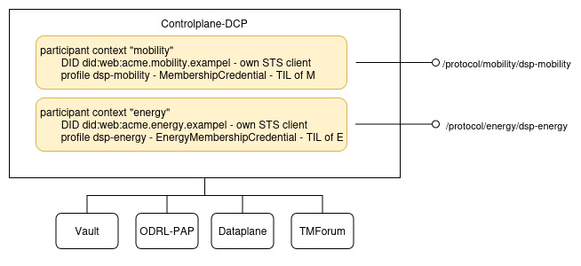

# Taking part in several dataspaces with one connector

One `controlplane-dcp` runtime can be a member of several dataspaces at the
same time — with a separate identity, separate credentials and separate trust
anchors in each, but one product catalogue, one TMForum, one Vault and one
deployment to operate.

This guide is for operators. It starts with what the feature is for, then shows
it running locally, and only then goes into configuration. If you already run a
single-dataspace `controlplane-dcp`, read
[Migrating an existing deployment](#migrating-an-existing-deployment) too — the
DSP URLs and the management API change.

The reasoning behind the design is recorded as ADRs in
[`multi-dataspace-design.md`](multi-dataspace-design.md).

> **Scope.** Only `controlplane-dcp` has this feature; it runs in EDC 0.18.1's
> *virtual participant-context mode*. `controlplane-oid4vc` and
> `controlplane-tck` keep the classic single-participant mode, and nothing in
> this guide applies to them.

## Contents

- [What it is for](#what-it-is-for)
- [How it works](#how-it-works)
- [See it running: the two-dataspace demo](#see-it-running-the-two-dataspace-demo)
- [Setting it up](#setting-it-up)
- [Offering a product in one, several or all dataspaces](#offering-a-product-in-one-several-or-all-dataspaces)
- [Configuration reference](#configuration-reference)
- [Managing it: the management API](#managing-it-the-management-api)
- [DCP scopes and trusted issuers](#dcp-scopes-and-trusted-issuers)
- [Migrating an existing deployment](#migrating-an-existing-deployment)
- [Verifying a deployment](#verifying-a-deployment)
- [Limitations and pitfalls](#limitations-and-pitfalls)

## What it is for

Take a data provider that is a member of a mobility dataspace and, from next
quarter, also of an energy dataspace. The two dataspaces share nothing: each has
its own membership credential, its own trusted issuers, possibly its own DSP
profile — and the provider has a different DID in each of them. Yet it is the
same company, selling partly the same data products, with one product
catalogue and one operations team.

Without this feature that means two connectors: two deployments, two TMForums,
two sets of products to keep in sync, and an offer modelled twice if it is sold
in both places.

With it, one runtime holds both memberships:


What you get from that:

- **One catalogue, many markets.** A product is modelled once. Each offering
  says which dataspaces it is made in — one, several, or all of them — and may
  carry different policies per dataspace.
- **Real separation where it matters.** Each dataspace has its own DID, its own
  STS client and secret, its own requested credentials and its own trusted
  issuer list. A counter-party in one dataspace never sees the other's offers,
  negotiations or agreements.
- **One thing to operate.** One image, one TMForum, one Vault, one set of
  dashboards. Adding a dataspace is a configuration change, not a new
  deployment.

What it does *not* do: it does not merge the dataspaces. Negotiations,
agreements and transfers always belong to exactly one of them, and a credential
accepted in one is not accepted in the other unless both trust its issuer.

## How it works

Three terms, and the connection between them:

**Dataspace** — a group of participants with a shared trust framework: who
issues membership credentials, which issuers are trusted, which DSP version is
spoken.

**Participant context** — one dataspace is one participant context. The context
holds what identifies the connector *in that dataspace*: its DID and its STS
client. Negotiations, agreements and transfers belong to exactly one context.
Contexts are created from configuration at startup, not by hand. If you use the
same DID in two dataspaces, still configure two contexts, so that their data and
policies stay apart.

**Dataspace profile** — a profile describes *how* the connector talks DSP: the
protocol version and binding, the JSON-LD namespace and contexts. A profile
carries no DID, no STS and no trusted issuers. A context is associated with one
or more profiles and is reachable only through them. On top of upstream, this
repository keys two things by profile: DCP scopes and the EBSI Trusted Issuers
List (TIL).

In short: a **dataspace** maps to a **participant context** (who we are there),
which speaks one or more **profiles** (how we talk there).

### What the counter-party sees

Both dimensions are in the URL:

```
<web.http.protocol.path>/<participant context id>/<profile name>/<catalog|negotiations|transfers>/...
```

With the example configuration, dataspace A's catalog is at

```
http://edc:8282/protocol/dataspace-a/dsp-dataspace-a/catalog/request
```

- A request for a profile that is not associated with the context, or for an
  unknown context, returns **404**. A request for an associated profile without
  a valid DCP token returns **401**. (Routing answers before authentication, so
  the two cases are distinguishable from outside.)
- DSP version metadata is served per context at
  `<web.http.protocol.path>/<participant context id>/.well-known/dspace-version`
  and lists only that context's profiles. There is no root
  `.well-known/dspace-version` any more.
- The callback address the connector advertises must contain the context. Set
  `edc.dsp.callback.address` with a `%s`, which is replaced by the participant
  context id, e.g. `http://edc:8282/protocol/%s`.
- Publish each context's DSP address — in the DID document's service entry, or
  wherever your dataspace announces connectors — with both the context id and
  the profile name in it.

The OpenID discovery document that APISIX uses to verify EDR tokens is per
context as well: `/.well-known/openid-configuration/<base64url(context id)>` on
the default API (`web.http.path`), without padding. The bare
`/.well-known/openid-configuration` answers for the default context
(`tmfExtension.defaultParticipantContextId`) and returns 404 if none is
configured. Routes created by `fdsc-transfer-extension` point at the right
document automatically, and all contexts share one JWKS.

### What is shared and what is not

| Per context (per dataspace) | Shared by all dataspaces |
|---|---|
| DID and STS client, with its own Vault secret alias | TMForum (products, offerings, quotes, agreements) |
| The profiles it is reachable through | Vault, ODRL-PAP, data plane |
| Its negotiations, agreements and transfers | The runtime, its ports and its management API |
| Per profile: DCP scopes, trusted issuers list | |

## See it running: the two-dataspace demo

The repository contains a complete two-dataspace stack: one connector with the
contexts `dataspace-a` and `dataspace-b`, one shared TMForum seeded with
offerings for both, a Vault, a static file server for the JSON schemas, and a
verifier that asserts the whole setup.

```bash
mvn package -pl controlplane-dcp -am -DskipTests
docker compose -f docker-compose.multi-dataspace.yml up --build -d --wait
docker compose -f docker-compose.multi-dataspace.yml run --rm verify
docker compose -f docker-compose.multi-dataspace.yml down -v
```

The verifier prints one line per check and exits non-zero if any fails. It
covers: both contexts exist and are listed by the management API; both see the
shared product; a token scoped to B may read it in B but not through A; DSP
profile routing answers 401/404 as described above; version metadata is per
context and absent at the root; and TMForum returns the right offerings per
context.

### The seeded catalogue

`scripts/init-tmforum-multi-dataspace.sh` seeds exactly the cases you will have
to model yourself:

| Product | Offering | `participantContextIds` | Offered in |
|---|---|---|---|
| `MDS-SHARED` | `MDS-OFFER-SHARED-A` | `["dataspace-a"]` | A, with the `use` action |
| `MDS-SHARED` | `MDS-OFFER-SHARED-B` | `["dataspace-b"]` | B, with the `read` action — same product, different policy |
| `MDS-A-ONLY` | `MDS-OFFER-A-ONLY` | `["dataspace-a"]` | A only |
| `MDS-ALL` | `MDS-OFFER-ALL` | `["*"]` | every context, including ones added later |
| `MDS-LEGACY` | `MDS-OFFER-LEGACY` | *absent* | the default context only — here `dataspace-a` |

### Poking at it yourself

While the stack is up, the DSP ports are published on localhost. None of these
need a token:

```bash
# an associated profile: routing is fine, the DCP token is missing  -> 401
curl -s -o /dev/null -w '%{http_code}\n' -X POST \
  http://localhost:8282/protocol/dataspace-a/dsp-dataspace-a/catalog/request

# B's profile is not associated with A                              -> 404
curl -s -o /dev/null -w '%{http_code}\n' -X POST \
  http://localhost:8282/protocol/dataspace-a/dsp-dataspace-b/catalog/request

# version metadata lists only A's profiles
curl -s http://localhost:8282/protocol/dataspace-a/.well-known/dspace-version | jq

# the offerings TMForum holds for B (its own, plus the wildcard one).
# TMForum publishes no host port, so ask it from inside the stack:
docker compose -f docker-compose.multi-dataspace.yml exec -T tmforum curl -s \
  'http://localhost:8632/tmf-api/productCatalogManagement/v4/productOffering?participantContextIds=dataspace-b,*' \
  | jq '[.[].externalId]'
```

The last query returns B's two offerings and, deliberately, **not**
`MDS-OFFER-LEGACY`: a TMForum filter can only match what is tagged. The
connector's own catalog for the *default* context does include untagged
offerings — it fetches them unfiltered and sorts them out in memory. That is the
one place where a raw TMForum query and the connector's view differ on purpose.

A full DSP catalog exchange is out of the demo's scope, because it needs a DCP
wallet and a credential issuer on both sides.

## Setting it up

The example configuration
[`config/multi-dataspace/edc.properties`](../config/multi-dataspace/edc.properties)
is a complete, commented file for two dataspaces; the steps below are the order
in which to fill it in. Every key is described in the
[configuration reference](#configuration-reference).

**1. Pick a context id per dataspace.** It appears in your DSP URLs and in the
TMForum tags, so choose it once and keep it. It must not contain `@`; `:` is
allowed, so DID- or URN-shaped ids work.

**2. Declare the profiles.** One profile per dataspace is the useful default,
because scopes and trusted issuers are keyed by profile:

```properties
edc.dataspace.profiles.a.name=dsp-dataspace-a
edc.dataspace.profiles.a.protocol.version=2025-1
edc.dataspace.profiles.a.protocol.binding=HTTPS
edc.dataspace.profiles.a.protocol.namespace=https://w3id.org/dspace/2025/1/
edc.dataspace.profiles.a.jsonld.context.urls=https://w3id.org/dspace/2025/1/context.jsonld,https://w3id.org/edc/dspace/v0.0.1
```

Upstream's default profile `http-dsp-profile-2025-1` is registered only while
**no** profile is configured, so declare it explicitly as well if a context
should keep using it. Avoid `:` in profile names.

**3. Declare the contexts.** Each one gets its id, its DID, the profiles it is
reachable through, and its own STS client:

```properties
fdsc.participants.a.id=dataspace-a
fdsc.participants.a.identity=did:web:dataspace-a.example.org
fdsc.participants.a.profiles=dsp-dataspace-a,http-dsp-profile-2025-1
fdsc.participants.a.config.edc.iam.sts.oauth.token.url=http://keycloak-a:8080/realms/dataspace-a/protocol/openid-connect/token
fdsc.participants.a.config.edc.iam.sts.oauth.client.id=edc-dataspace-a
fdsc.participants.a.config.edc.iam.sts.oauth.client.secret.alias=dataspace-a-sts-client-secret
```

Store each STS secret in the Vault under its own alias — the convention is
`<context id>-sts-client-secret`.

**4. Set the callback address** with `%s`:
`edc.dsp.callback.address=http://edc:8282/protocol/%s`. Do not set
`web.http.protocol.virtual`; it is only a fallback for deployments without an
explicit callback address.

**5. Set up management access.** The management API is v5 and needs an OAuth2
JWT: point `edc.iam.oauth2.issuer` and `edc.iam.oauth2.jwks.url` at your
identity provider, see
[Managing it](#managing-it-the-management-api).

**6. Point TMForum at the schemas and name the default context.** Serve
`schemas/` somewhere TMForum can reach, set `tmfExtension.schemaBaseUri` to that
base (with the trailing `/`), and set `tmfExtension.defaultParticipantContextId`
to the dataspace that owns your untagged data. See
[TMForum](#tmforum).

**7. Tag your offerings** with the dataspaces they are made in, see
[Offering a product](#offering-a-product-in-one-several-or-all-dataspaces).

**8. Per-dataspace credentials and trust.** Give a dataspace its own requested
credential with `dcp.profiles.<profile>.scopes.*` and its own trusted issuers
with `ebsiTir.profiles.<profile>.tilAddress`, see
[DCP scopes and trusted issuers](#dcp-scopes-and-trusted-issuers).

Then start the runtime and work through
[Verifying a deployment](#verifying-a-deployment).

### Adding another dataspace later

Declare its profile (with its own scope and TIL overrides if needed), declare
another `fdsc.participants.<key>` with its DID, STS client and a distinct STS
secret alias, store that secret in the Vault, and tag the offerings it should
see. Existing untagged offerings stay in the default context and are **not**
exposed in the new dataspace until you tag them.

## Offering a product in one, several or all dataspaces

Model the product once, as one ProductSpecification. Then decide per offering
where it is offered, with `participantContextIds`:

| `participantContextIds` | Offered in |
|---|---|
| absent or empty | the default context only |
| `["dataspace-a"]` | dataspace A only |
| `["dataspace-a", "dataspace-b"]` | dataspaces A and B |
| `["*"]` | every context, including contexts added later |

- **Same policies everywhere:** one ProductOffering whose
  `participantContextIds` lists the dataspaces, or `["*"]`.
- **Different policies per dataspace:** one ProductOffering per dataspace, each
  tagged with its dataspace and each referencing the same ProductSpecification.
- **Untagged offerings stay in the default context only.** Absent does not mean
  "everywhere": adding a second dataspace never exposes existing offers there
  until you tag them.
- Write `participantContextIds` only with at least one entry. TMForum stores an
  empty array as `[{}]`; the connector treats it as absent, but omit it instead.

Example offering (abridged) made in A and B:

```json
{
  "name": "weather-data-offer",
  "externalId": "weather-data-offer",
  "@schemaLocation": "https://schemas.example.org/fdsc-edc/external-id.json",
  "productSpecification": { "id": "<TMForum id of the ProductSpecification>" },
  "participantContextIds": ["dataspace-a", "dataspace-b"]
}
```

The `productOfferingTerm` with the access and contract policies is the same as
for a single-dataspace offering and is omitted here;
[`scripts/init-tmforum-multi-dataspace.sh`](../scripts/init-tmforum-multi-dataspace.sh)
creates complete offerings for every case in the table above.

### How the connector tags TMForum data

Products are shared; everything that happens *in* a dataspace is tagged with the
context it belongs to:

| TMForum entity | EDC entity | Tag |
|---|---|---|
| ProductSpecification | Asset | none: a product is shared by all dataspaces |
| ProductOffering (and its embedded policies) | ContractDefinition, PolicyDefinition | `participantContextIds`: array of context ids, or `["*"]` |
| Quote, QuoteItem | ContractNegotiation | `participantContextId` |
| Agreement | ContractAgreement | `participantContextId` |
| Usage | — (reserved) | `participantContextId` is in the schema, but the connector does not write Usage yet; transfer processes are not stored in TMForum |
| Product, ProductOrder, ProductSpecificationRef | — | none: reached only through a tagged Quote or Agreement |

The connector writes the tag on the quotes and agreements it creates; you tag
only the offerings you create. All properties are optional in the schemas, so
existing data stays valid, and an entity without a tag belongs to the context
named by `tmfExtension.defaultParticipantContextId`.

### Keeping ids unique

Offering `externalId`s and policy ids must stay globally unique across all
dataspaces; a duplicate is a data error and the lookup fails. EDC gives a
contract definition exactly one context, so the ids it sees are:

- an offering for **one** context (untagged, or one id) keeps its plain
  `externalId` as contract definition id, and its policies keep their ids;
- an offering for **several or all** contexts appears in context X as
  `<externalId>@X`, and its policies as `<policyId>@X`.

Consequently **no other offering or policy id may equal
`<multi-context id>@<context>`**. If a single-context offering's `externalId` is
literally `foo@dataspace-b` while a multi-context offering `foo` serves
`dataspace-b`, both resolve to the same id. The connector logs a `SEVERE`
message naming both offerings, and negotiating that id fails until the data is
fixed. Context ids must not contain `@` (startup fails otherwise); offering ids
may, as long as they do not collide in this way.

## Configuration reference

### Which setting belongs where

| Setting | Scope | Where it is configured |
|---|---|---|
| DID (`edc.participant.did`) | per context | `fdsc.participants.<key>.identity` |
| STS token URL, client id, client secret alias (`edc.iam.sts.oauth.*`) | per context | `fdsc.participants.<key>.config.*` |
| Profiles the context is reachable through (`edc.dataspace.profiles`) | per context | `fdsc.participants.<key>.profiles` |
| Vault settings (`edc.vault.hashicorp.config`) | per context, optional | `fdsc.participants.<key>.privateConfig.*` |
| DSP version, binding, JSON-LD namespace and contexts | per profile | `edc.dataspace.profiles.<key>.*` |
| DCP scopes (upstream) | per profile | `edc.iam.dcp.scopes.<key>.*` |
| DCP scopes per request type | global default, per-profile override | `dcp.scopes.*`, `dcp.profiles.<profile>.scopes.*` |
| Trusted Issuers List | global default, per-profile override | `ebsiTir.tilAddress`, `ebsiTir.profiles.<profile>.tilAddress` |
| TMForum, ODRL-PAP, Vault, FDSC transfer (`fdscTransfer.*`) | shared by all dataspaces | as for a single-dataspace deployment |

DCP scopes and the TIL are keyed by *profile*, not by context: upstream picks
scopes from the request's profile, and the trust check runs where only the
profile is known. Give each dataspace its own profile when its scopes or TIL
differ, as in the example.

### `fdsc.participants.*`

Read by `participant-bootstrap-extension`. Each `<key>` declares one participant
context. The key is only a label for the settings; the context id is `.id`.

| Key | Required | Meaning |
|---|---|---|
| `fdsc.participants.<key>.id` | yes | Participant context id. Appears in DSP URLs and in TMForum tags. Must not contain `@`. `:` is allowed, so DID- or URN-shaped ids work |
| `fdsc.participants.<key>.identity` | yes | The context's DID. Stored as the context identity and as the `edc.participant.did` config entry. This is the only place to set the DID |
| `fdsc.participants.<key>.profiles` | no | Comma-separated profile names (`edc.dataspace.profiles.<k>.name`). Stored as the context's `edc.dataspace.profiles` entry. A context with no profile is unreachable over DSP |
| `fdsc.participants.<key>.config.<edcKey>` | no | Plain context config entries, e.g. `edc.iam.sts.oauth.token.url`, `edc.iam.sts.oauth.client.id`, `edc.iam.sts.oauth.client.secret.alias` |
| `fdsc.participants.<key>.privateConfig.<edcKey>` | no | Sensitive context config entries, e.g. `edc.vault.hashicorp.config`. Stored encrypted (see below) |

Startup fails with a message naming the participant when:

- `.id` or `.identity` is missing or blank, or two participants share an `.id`;
- `.id` contains `@`;
- a profile in `.profiles` is not registered (check the
  `edc.dataspace.profiles.*` names);
- `.config.` or `.privateConfig.` sets `edc.participant.id`,
  `edc.participant.did` or `edc.iam.issuer.id` to a value other than
  `.identity` (an equal value is accepted);
- `.config.` or `.privateConfig.` sets `edc.dataspace.profiles` (use
  `.profiles`);
- participants are declared on a runtime without the virtual participant-context
  services (i.e. not `controlplane-dcp`).

Seeding is an upsert and runs on every start. A context that already exists, for
example one created through the management API, is updated and not duplicated.
Its configuration is **replaced** by the declared entries, so changes made at
runtime through the management API to a declared context's config are lost on
restart. Without the SQL store (see
[Limitations](#limitations-and-pitfalls)) contexts live in memory; contexts
created only through the management API are gone after a restart.

**Private entries** are encrypted with the algorithm
`edc.participants.config.encryption.algorithm` (the example uses `aes`, with the
key read from the Vault under `edc.encryption.aes.key.alias`).

**STS secrets.** All contexts share the global Vault configuration
(`edc.vault.hashicorp.*`). The STS client secret is resolved per context from
`edc.iam.sts.oauth.client.secret.alias`, so give every context a distinct alias.
The convention is `<context id>-sts-client-secret`. The alias is set explicitly,
not derived, so you control the Vault key layout. For hard isolation, set the
context's private entry `edc.vault.hashicorp.config` (a JSON
`HashicorpVaultSettings` object, e.g. with its own `folder`). Without it the
context falls back to the global Vault settings, because
`edc.vault.hashicorp.allowfallback` defaults to `true`.

### `edc.dataspace.profiles.*`

Upstream keys. Each `<key>` registers one profile:

| Key | Meaning |
|---|---|
| `edc.dataspace.profiles.<key>.name` | Profile name. Appears in DSP URLs, in `fdsc.participants.<key>.profiles` and in the per-profile `dcp.profiles.*`, `ebsiTir.profiles.*` and `edc.iam.dcp.scopes.*.profile` settings |
| `edc.dataspace.profiles.<key>.protocol.version` | DSP version, e.g. `2025-1` |
| `edc.dataspace.profiles.<key>.protocol.binding` | DSP binding, e.g. `HTTPS` |
| `edc.dataspace.profiles.<key>.protocol.namespace` | DSP JSON-LD namespace, e.g. `https://w3id.org/dspace/2025/1/` |
| `edc.dataspace.profiles.<key>.jsonld.context.urls` | Comma-separated JSON-LD context URLs |

- Upstream's default profile `http-dsp-profile-2025-1` is registered only while
  **no** profile is configured. As soon as you declare any profile, declare the
  default one explicitly too if a context should keep using it (the example
  does).
- Use profile names without `:`. The name is part of the
  `dcp.profiles.<profile>.*` and `ebsiTir.profiles.<profile>.*` keys. A `:` must
  be escaped as `\:` in a `.properties` file and cannot be written in an
  environment variable at all.
- Do not set `edc.dataspace.enable.profiles.all=true`. It skips the
  context–profile association, so every context becomes reachable through every
  profile.

### DSP callback address

| Key | Meaning |
|---|---|
| `edc.dsp.callback.address` | Must contain `%s`, replaced by the participant context id, e.g. `http://edc:8282/protocol/%s` |
| `web.http.protocol.virtual` | Fallback only: appends `/%s` to the default callback address when `edc.dsp.callback.address` is not set. It changes no routes, so do not set it when the callback address is set |

### TMForum

All dataspaces share one TMForum (`tmfExtension.*`, unchanged). Two settings
matter for multi-dataspace operation:

| Key | Meaning |
|---|---|
| `tmfExtension.defaultParticipantContextId` | Context that owns TMForum entities without a context tag (legacy data). **Required in virtual mode**: without it untagged offerings, quotes and agreements are invisible, and a warning is logged at startup. Set it to the context of the dataspace the deployment served before |
| `tmfExtension.schemaBaseUri` | Base URL of the JSON schemas written as `@schemaLocation` on extended TMForum entities. **Must point at a copy of this repository's `schemas/` that TMForum can reach** (see below) |

**Publish the schemas.** TMForum fetches the `@schemaLocation` of every create or
update that carries extension properties, and answers 400 if the URL is
unreachable. The default `schemaBaseUri` is an external GitHub URL that does not
contain the new `participantContextId(s)` properties: writes against it still
succeed, but the new properties are not type-checked, and a TMForum without
internet access rejects every extended write. Serve `schemas/` from a web server
inside your cluster (the compose file uses a static nginx) or publish it at a
stable URL, and set `tmfExtension.schemaBaseUri` to that base, including the
trailing `/`. Your TMForum seeding scripts must use the same base for the
`@schemaLocation`s they write.

`tmfExtension.*` keys are camelCase and therefore cannot be set through
environment variables. Use the properties file or JVM system properties
(`-DtmfExtension.schemaBaseUri=...`).

### Walkthrough of the example configuration

[`config/multi-dataspace/edc.properties`](../config/multi-dataspace/edc.properties)
configures two dataspaces, A and B, sharing one TMForum, ODRL-PAP and Vault.
Host names, DIDs and URLs are placeholders.

1. **Runtime and web contexts.** The usual `web.http.*` ports and paths.
   `edc.participant.id` is dataspace A's DID; it is used only as the identity of
   untagged TMForum entities in the default context, not as a runtime-wide
   identity.
2. **DSP callback address.** `edc.dsp.callback.address=http://edc:8282/protocol/%s`;
   `web.http.protocol.virtual` is not set.
3. **Dataspace profiles.** Three DSP 2025-1 profiles: upstream's default
   `http-dsp-profile-2025-1` (declared explicitly, because declaring any profile
   drops the implicit one), `dsp-dataspace-a` and `dsp-dataspace-b`.
4. **Participant contexts.**
   - `dataspace-a` with DID `did:web:dataspace-a.example.org`, its own STS
     client, and profiles `dsp-dataspace-a` and `http-dsp-profile-2025-1`;
   - `dataspace-b` with DID `did:web:dataspace-b.example.org`, its own STS
     client, and only profile `dsp-dataspace-b`. So
     `/protocol/dataspace-b/http-dsp-profile-2025-1/...` returns 404.
   - The STS secret aliases follow `<context id>-sts-client-secret`.
5. **Management API v5.** `edc.iam.oauth2.issuer` and `edc.iam.oauth2.jwks.url`
   point at a Keycloak realm `edc-management`.
6. **Vault and private participant config.** One HashiCorp Vault for all
   contexts. Private participant config entries are encrypted with AES, using
   the key stored in the Vault under `participant-config-aes-key`.
7. **DCP scopes.** Every profile requests `MembershipCredential` for catalog,
   negotiation and transfer. `dsp-dataspace-b` overrides all three with
   `DataspaceBMembershipCredential`, so B's counter-parties are asked only for
   B's credential.
8. **EBSI TIR.** `ebsiTir.tilAddress` is A's TIL and serves every profile
   without its own; `dsp-dataspace-b` trusts only the issuers of its own TIL.
9. **TMForum.** One shared TMForum.
   `tmfExtension.defaultParticipantContextId=dataspace-a` puts all untagged
   entities into dataspace A. Set `tmfExtension.schemaBaseUri` to your hosted
   `schemas/` (the compose file passes it as a JVM property).
10. **FDSC transfer and ODRL-PAP.** Configured as for one dataspace and shared by
    both. The ODRL-PAP input of an agreement carries its `participantContextId`,
    so PAP policies can tell dataspaces apart.

## Managing it: the management API

The management API is **v5** (`/v5beta/...`) and requires an OAuth2 JWT. The v3
and v4 APIs are gone from the DCP image. Resources are scoped by context:

```
<web.http.management.path>/v5beta/participants                                   # contexts (admin)
<web.http.management.path>/v5beta/participants/<context id>/assets/request       # query assets
<web.http.management.path>/v5beta/participants/<context id>/assets/<asset id>
<web.http.management.path>/v5beta/participants/<context id>/contractnegotiations/...
```

There is no collection `GET` on assets; query with `POST .../assets/request` and
a QuerySpec body (`{}` for all).

| Key | Meaning |
|---|---|
| `edc.iam.oauth2.issuer` | Expected `iss` of management tokens. **Always set it**: if unset, only tokens *without* `iss` are accepted |
| `edc.iam.oauth2.jwks.url` | JWKS used to verify the token signature |
| `edc.iam.oauth2.jwks.cache.validity` | JWKS cache time (default 5 minutes) |

Tokens are checked for signature, `iss`, `exp`, `nbf` and `iat`. There is no
audience check. The claims used are:

- `scope` (space-separated): `management-api:read` and `management-api:write`
  for the endpoints, `management-api:admin` for access to every context and to
  `/v5beta/participants`;
- `sub`: with `management-api:admin` it can be anything; without it, `sub` must
  equal an existing context id, and the token can only reach that context's
  resources.

**With Keycloak** (the FIWARE Data Space Connector chart already deploys one):

1. Create a realm (or reuse one) for management access:
   `edc.iam.oauth2.issuer=<keycloak>/realms/<realm>` and
   `edc.iam.oauth2.jwks.url=<keycloak>/realms/<realm>/protocol/openid-connect/certs`.
2. Create the client scopes `management-api:admin`, `management-api:read` and
   `management-api:write`, included in the token's `scope` claim.
3. Operators use a client with the admin scope.
4. A client that should manage only one dataspace gets `read`/`write` (not
   `admin`) and a *hardcoded claim* mapper that sets `sub` to the context id.
   Keycloak otherwise puts the service account's user id into `sub`, which names
   no context, and every request gets 401.

## DCP scopes and trusted issuers

| Key | Meaning |
|---|---|
| `dcp.scopes.{catalog,negotiation,transfer}` | Scope requested for that request type in every profile without an override |
| `dcp.profiles.<profile>.scopes.{catalog,negotiation,transfer}` | Replaces the global scope of that request type for requests in `<profile>`. Unset request types fall back to `dcp.scopes.*` |
| `edc.iam.dcp.scopes.<key>.{id,type,value,profile}` | Upstream scopes. `type=DEFAULT` adds `value` to *every* request (catalog, negotiation and transfer) of `profile` |
| `ebsiTir.tilAddress` | Global Trusted Issuers List. Used for profiles without their own TIL |
| `ebsiTir.profiles.<profile>.tilAddress` | TIL of one profile. A request in that profile is accepted only if every credential issuer is trusted by this TIL |

With no `dcp.profiles.*` and `ebsiTir.profiles.*` set, DCP and TIR behave exactly
as in a single-dataspace deployment.

### Which scope mechanism to use

Two mechanisms add scopes to the DCP token request. Both run on every request
and their results are unioned, so they add up and never replace each other.

- **A scope a profile needs on every request** (catalog, negotiation and
  transfer alike): use the upstream keys.

  ```properties
  edc.iam.dcp.scopes.b-membership.id=b-membership
  edc.iam.dcp.scopes.b-membership.type=DEFAULT
  edc.iam.dcp.scopes.b-membership.value=org.eclipse.dspace.dcp.vc.type:DataspaceBMembershipCredential:read
  edc.iam.dcp.scopes.b-membership.profile=dsp-dataspace-b
  ```

- **A scope that differs per request type**: use `dcp.scopes.*` (all profiles)
  and `dcp.profiles.<profile>.scopes.*` (one profile). Upstream cannot express
  this, because a `DEFAULT` scope is added to all three request types.

  ```properties
  dcp.scopes.catalog=org.eclipse.dspace.dcp.vc.type:MembershipCredential:read
  dcp.scopes.negotiation=org.eclipse.dspace.dcp.vc.type:MembershipCredential:read
  dcp.scopes.transfer=org.eclipse.dspace.dcp.vc.type:MembershipCredential:read
  dcp.profiles.dsp-dataspace-b.scopes.transfer=org.eclipse.dspace.dcp.vc.type:DataTransferCredential:read
  ```

- `dcp.profiles.<profile>.scopes.<type>` is also the only way to stop a profile
  from requesting the global `dcp.scopes.<type>`: the override replaces it for
  that profile. An upstream scope cannot remove it. This is why the example
  configuration overrides all three types for dataspace B.
- **Never configure the same scope in both mechanisms.** It would be requested
  twice, and a later change to one of them would silently leave the other in
  place.

### How the per-profile trust check works

1. An issuer passes the general credential check if any TIL (global or any
   profile's) trusts it.
2. The profile check then rejects a request (401) unless every credential issuer
   is trusted by that profile's own TIL, or by the global TIL for a profile
   without one. So a dataspace never accepts an issuer that only another
   dataspace trusts.

A profile TIL that fails or times out is skipped (its issuers count as
untrusted) and not asked again for 30 seconds, so one dataspace's TIL outage
does not break the others. A failing global TIL still fails the request. TIL
lookups are not cached: each credential check queries the global TIL and every
profile TIL. Keep TIL HTTP timeouts short and place the TILs close to the
connector.

## Migrating an existing deployment

An existing `controlplane-dcp` deployment runs in classic mode. Upgrading the
image switches it to virtual mode, and **these things change for everyone**:

| What | Before | After |
|---|---|---|
| DSP endpoint | `<protocol>/2025-1/...` | `<protocol>/<context id>/<profile>/...` |
| DSP version metadata | `<protocol>/.well-known/dspace-version` | `<protocol>/<context id>/.well-known/dspace-version` |
| Callback address | `edc.dsp.callback.address=http://host/protocol` | must contain `%s`: `http://host/protocol/%s` |
| Management API | v3/v4 | v5 (`/v5beta/participants/<context id>/...`) with an OAuth2 JWT |
| Identity and STS | global `edc.participant.id`, `edc.iam.sts.oauth.*` | per context, in `fdsc.participants.<key>.*` |
| OpenID discovery for APISIX | `/.well-known/openid-configuration` | additionally `/.well-known/openid-configuration/<base64url(context id)>`; the bare path serves the default context |
| `test-extension` | bundled | removed from the DCP image (`testExtension.*` has no effect); TCK runs use `controlplane-tck` |

Your TMForum data needs no migration: it is all untagged and therefore belongs
to whichever context you name as the default.

1. **Pick a context id** for the dataspace you are already in, e.g.
   `dataspace-a`. It becomes part of your DSP URL, so choose it once. It must
   not contain `@`.
2. **Keep your data in it.** Set
   `tmfExtension.defaultParticipantContextId=<that id>`. All existing, untagged
   offerings, quotes and agreements belong to it. Keep `edc.participant.id` at
   your current DID.
3. **Publish the schemas** from `schemas/` where TMForum can reach them and set
   `tmfExtension.schemaBaseUri` to that URL (see [TMForum](#tmforum)).
4. **Declare the profile(s).** Declare `http-dsp-profile-2025-1` explicitly, plus
   any profile of your own, with `edc.dataspace.profiles.*`.
5. **Declare the context** with `fdsc.participants.<key>.*`:
   - `.id`: the id from step 1;
   - `.identity`: your current DID;
   - `.profiles`: the profiles from step 4;
   - `.config.edc.iam.sts.oauth.token.url`, `.config.edc.iam.sts.oauth.client.id`
     and `.config.edc.iam.sts.oauth.client.secret.alias`: your current global STS
     settings.
6. **Set the callback address** with `%s` and remove
   `web.http.protocol.virtual` if you set it.
7. **Set up management access**: configure `edc.iam.oauth2.issuer` and
   `edc.iam.oauth2.jwks.url` (see
   [Managing it](#managing-it-the-management-api)), and move every management
   client to the v5 paths and to OAuth2 tokens.
8. **Tell your counter-parties** the new DSP address
   (`<protocol>/<context id>/<profile>`), e.g. by updating the service entry of
   your DID document. Requests to the old `<protocol>/2025-1/...` paths return
   404.
9. **Update the APISIX discovery URL** only if you configured it by hand; routes
   created by the connector already use the right one.
10. **Verify** with the checks below.

## Verifying a deployment

- Startup logs one `Seeded participant context '<id>' (<DID>) with profiles [...]`
  line per context.
- `GET <management>/v5beta/participants` with an admin token lists every
  context.
- `GET <protocol>/<context id>/.well-known/dspace-version` returns 200 and lists
  that context's profiles.
- `POST <protocol>/<context id>/<profile>/catalog/request` without a token
  returns 401 for an associated profile and 404 otherwise.
- `GET <tmforum>/productCatalogManagement/v4/productOffering?participantContextIds=<context id>,*`
  lists the offerings made in that dataspace (the untagged ones of the default
  context are not included, see
  [the demo](#see-it-running-the-two-dataspace-demo)).

[`scripts/verify-multi-dataspace.sh`](../scripts/verify-multi-dataspace.sh) runs
these checks and more against the compose stack; see
[the demo](#see-it-running-the-two-dataspace-demo) for how to run it.

## Limitations and pitfalls

- **In-memory context store.** Contexts and their config live in memory and are
  re-seeded from `fdsc.participants.*` on every start. Declare every context in
  configuration; changes made only through the management API do not survive a
  restart.
- **One data plane for all contexts.** The DCP image keeps the legacy data plane
  signaling with one context-less data plane instance, which serves every
  context.
- **Environment variables.** EDC maps `FOO_BAR_BAZ` to `foo.bar.baz`, so
  camelCase keys (`fdsc.participants.<key>.privateConfig.*`, `tmfExtension.*`,
  `ebsiTir.*`, `odrlPap.*`, `fdscTransfer.*`), participant keys containing `_`,
  and profile names containing `:` cannot be set through environment variables.
  Use the properties file (`EDC_FS_CONFIG`) or JVM system properties.
- **Profile names with `:`** must be escaped (`\:`) in properties keys. Prefer
  `:`-free names for profiles with per-profile overrides.
- **TIL latency** adds up across dataspaces, see
  [DCP scopes and trusted issuers](#dcp-scopes-and-trusted-issuers).
- **Shared ODRL-PAP.** Policies of all dataspaces are evaluated by one PAP; use
  the agreement's `participantContextId` in PAP policies where dataspaces must
  differ.
